  
  <h1>Tareku99</h1>
  
<em>Hobbyist developer and maker building practical tools for 3D printing, automation, and whatever I’m curious about.</em>

  

    
  

  

    
    
  

## Projects

- [Snapmaker U1 Extended Firmware](https://github.com/paxx12-snapmaker-u1/SnapmakerU1-Extended-Firmware) — I contribute build reliability and firmware configuration improvements.
- [U1 Obico Installer](https://github.com/Tareku99/snapmaker_u1_obico) — Automated Obico installation for the Snapmaker U1 with Extended Firmware.
- [ACELink](https://github.com/Tareku99/ACELink) — Work with Anycubic ACE Pro devices without an Anycubic printer.
- [AniList ↔ MyAnimeList Sync](https://github.com/Tareku99/anilist-mal-sync) — Sync anime lists between the two services, with OAuth, conflict handling, and Docker deployment.
